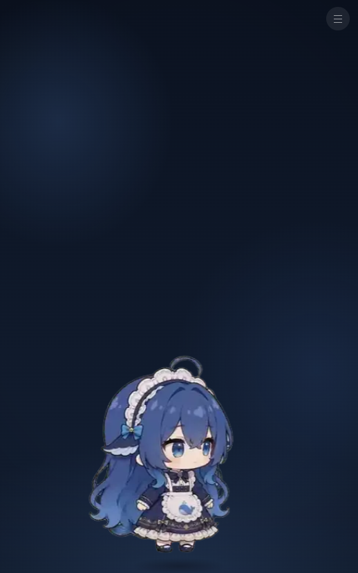

# 小呆 iOS 版（dsh-pet 移植）

把 `base(1).apk`（包名 `io.dsh.pet`，v1.1.1）里的**宠物动画、点击反应、拖拽抛掷**搬到 iPhone 上，
做成一个能用 Xcode 编译、能签名的真实 iOS 工程。



---

## 一、先讲清楚三件事

**1. 这不是"APK 转 IPA"。**
APK 是 Android 的 Dalvik/ART 字节码 + ARM 原生库，IPA 是 arm64 Mach-O + 代码签名，两者没有转换关系。
这个工程是把原 App 的**动画素材和行为逻辑**重新实现成 iOS 原生壳（Swift + WKWebView），
所以它叫"移植"，不叫"转换"。

**2. iOS 上做不到"小呆飘在微信上面"。**
原 App 靠四个 Android 独有能力吃饭，iOS 全部不提供：

| 原 App 能力 | Android 实现 | iOS |
|---|---|---|
| 悬浮在任意 App 之上 | `SYSTEM_ALERT_WINDOW` | ❌ 系统不开放 |
| 读屏/点击别的 App | `AccessibilityService` | ❌ 不存在 |
| 提权 | Shizuku | ❌ 不存在 |
| 开机自启 | `BOOT_COMPLETED` 广播 | ❌ 不允许 |

所以 iPhone 上的小呆只能活在自己的 App 里：全屏、深色背景、她在屏幕下方走动。
这是平台限制，不是实现偷懒。

**3. 没有任何人能"保证不出 bug"。**
这份工程能做到的是：不崩溃、不白屏、每个动画都实际跑过一遍、装坏了能删掉重来。
真正把握不了的是**签名安装**这一段（见第五节），它取决于苹果的政策和你的 Apple ID。

---

## 二、你拿到了什么

```
pet-ios/
├─ project.yml                    # Xcode 工程描述（XcodeGen 生成 .xcodeproj）
├─ .github/workflows/build-ipa.yml# GitHub Actions：自动编译出未签名 IPA
├─ ios/Pet/
│  ├─ AppDelegate.swift           # 入口
│  ├─ PetViewController.swift     # WKWebView 宿主 + 触感反馈桥
│  ├─ Info.plist                  # 竖屏、深色、无 Storyboard
│  ├─ Assets.xcassets/            # App 图标（1024×1024）
│  └─ web/                        # 全部运行时代码与素材（离线）
│     ├─ index.html
│     ├─ style.css
│     ├─ app.js                   # 动画链、点击、拖拽物理
│     ├─ pet-data.js              # 动作清单与时长（构建时生成）
│     └─ anim/*.webp              # 48 个动作，61 MB
└─ README.md
```

**已包含 48 个动作**：待机、东张西望、被拖拽悬空、5 种点击回应、3 种走路，
外加"小动作 / 玩耍 / 吃什么 / 时节 / 文字"五个分类里挑的 36 个随机动作。

**为什么只有 48 个而不是 106 个**：原包 106 段动画共 10 分钟画面。
iOS 不支持带透明通道的 VP9 WebM，只能转成动图 WebP，而 WebP 的压缩率比 VP9 差约 10 倍——
106 个全塞进去要 134 MB。48 个是"体积 / 丰富度"的折中（61 MB）。
想加回去见第六节，一条命令的事。

---

## 三、三步拿到 IPA

你没有 Mac，所以用 GitHub 的 macOS 机器编译（免费额度够用）。

### 第 1 步：把工程传到 GitHub

- 有 git：`git init && git add . && git commit -m init`，推到新建的空仓库。
- 没有 git：打开 https://github.com/new 建一个**私有**仓库 → 进入仓库 →
  `Add file` → `Upload files` → 把 `pet-ios` 里的**所有文件和文件夹**拖进去 → Commit。
  （61 MB，网慢的话分两次传：先传除 `ios/Pet/web/anim` 外的所有内容，再单独传 `anim` 文件夹。）

> 仓库必须包含 `.github/workflows/build-ipa.yml`，否则第 2 步看不到按钮。
> 用网页上传时，以 `.` 开头的文件夹可能被忽略，上传后确认一下它存在。

### 第 2 步：让它编译

仓库页面 → **Actions** → 左侧 **Build unsigned IPA** → 右侧 **Run workflow** → 绿色按钮。
大约 3–6 分钟（首次要装 XcodeGen）。

### 第 3 步：下载

跑完后点进这次运行，页面底部 **Artifacts** → `Pet-unsigned-ipa` → 得到一个 zip，里面是
`Pet-unsigned.ipa`。

---

## 四、装到 iPhone 13 Pro Max

未签名的 IPA 不能直接装，要本地签名。Windows 上最省事的是 **Sideloadly**：

1. 电脑装 **iTunes**（微软商店版即可，提供苹果驱动）和 **Sideloadly**（sideloadly.io）。
2. 数据线连手机，手机上点"信任此电脑"。
3. 打开 Sideloadly，把 `Pet-unsigned.ipa` 拖进窗口。
4. `Apple ID` 填你的 Apple ID（普通账号即可，不用开发者账号）。
5. 点 **Start**，输入 Apple ID 密码（会发给苹果验证，不是给第三方）。
6. 手机桌面出现"小呆"→ 首次打开会提示"未受信任的开发者"→
   **设置 → 通用 → VPN与设备管理 → 你的 Apple ID → 信任**。
7. 打开即可。

**免费账号的三个限制（苹果定的，绕不过）：**
- 证书 **7 天**过期，过期后 App 打不开，要重连电脑重新签名（存档和设置不会丢，重签覆盖即可）。
- 同时最多 **3 个**自签 App。
- 想长期用，就上 99 美元/年的开发者账号（1 年有效），或者用 AltStore 自动续签（需要一台常开的电脑）。

---

## 五、操作说明

| 操作 | 效果 |
|---|---|
| 点一下小呆 | 随机播放一个"点击回应"动画 + 触感反馈 |
| 按住拖动 | 播放"被拖拽悬空"动画，跟着手指走 |
| 甩出去 | 带初速度抛出，重力下落、落地弹跳（恢复系数 0.62） |
| 什么都不做 | 按权重随机：待机 / 东张西望 / 走路 / 分类动作 |
| 右上角 ☰ | 打开全部 48 个动作的列表，点任意一个立刻播放 |

物理参数（重力 1500 px/s²、弹跳 0.62、抛掷衰减 0.55）在 `app.js` 的 `tick()` 和 `onUp()` 里，
想调手感直接改数字。

---

## 六、想加回更多动作

转换流水线在我这边跑过一遍，产物在 `anim/` 里只有入选的 48 个。
如果你想要剩下的 58 个（总共约 134 MB），把需求告诉我就行，我重新出一个包——
只需要改 `gen_data.py` 的体积预算参数（例如 `62` → `140`），重新生成 `pet-data.js` 和 `anim/`。

体积和动作数的换算很线性：**每个动作 ≈ 1.27 MB**。

---

## 七、已知风险（不藏着）

1. **我没法在这台机器上编译验证。** 这里没有 macOS/Xcode，Swift 与 Xcode 工程是按标准写法写的，
   但“第一次 CI 编译”才是真正的验收。如果 Actions 报错，把日志（或 `build-log` artifact）发我，我改。
2. **iOS 版本没实测过。** 你的是 iOS 27.2；工程按 iOS 16.0 最低版本写，用的是 WKWebView +
   动图 WebP，都是老 API，理论上不会随系统版本坏掉。但真机第一次运行仍需你确认。
3. **动画是 15 fps。** 源片 23.8 fps，为了体积降到 15 fps。慢动作里能看出轻微不连贯，
   想更顺就调高 `OUT_FPS` 重新生成（体积线性上涨）。
4. **首次启动有 1–2 秒加载。** 第一个动画要从 61 MB 素材里解码，之后有浏览器缓存，正常。
5. **耗电。** 动图 WebP 由系统解码，比 video 省，但持续播放仍会耗电；进后台会自动暂停。

---

## 八、给想改代码的人

- 改动画选择权重：`web/pet-data.js` 里的 `weights`、`categories[].weight`。
- 改外观：`web/style.css`（背景渐变、光晕、暗角）。
- 改原生行为（触感、状态栏、禁止旋转）：`PetViewController.swift`。
- 改 App 名/包名：`ios/Pet/Info.plist` 的 `CFBundleDisplayName`、`project.yml` 的
  `PRODUCT_BUNDLE_IDENTIFIER`（改成你自己的，避免和别人的签名冲突）。

## 九、版本

- 移植版本：1.1.1（对齐 APK 的 versionName）
- 素材来源：dsh-pet 0.3.7
- 动作数：48 / 106
